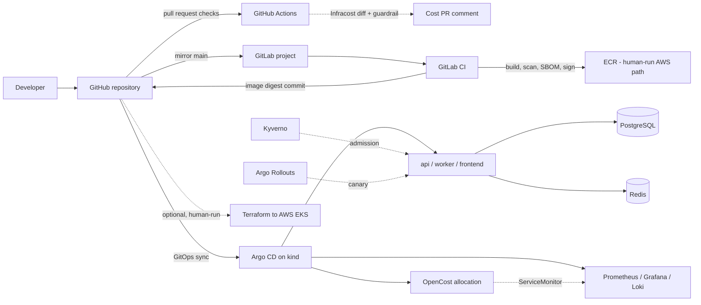

# Cloud Platform in a Box

A production-style Kubernetes platform you can run locally for **$0**: GitOps,
progressive delivery, policy-as-code, observability, SLOs, and a supply chain
that signs what it ships. The AWS EKS production path is written and validated
with Terraform, but it is optional and is never applied by the agent.

> **Status: Phase 10 — FinOps.** Cost formulas, an optional Infracost PR
> comment with warn/block thresholds, spot-first Karpenter parameters, an
> OpenCost namespace dashboard, AWS Cost Explorer reporting and pause/teardown
> guidance are written and statically validated. No live cost API or AWS
> resource was used by the agent. GitHub Actions and GitLab CI remain
> offline-validated; live pipelines need human-supplied tokens and OIDC roles.
> The local platform and its application manifests run on `kind`.
> See [PROGRESS.md](PROGRESS.md) for the phase plan and current state, and
> [docs/architecture.md](docs/architecture.md) for the delivery model.

## What this demonstrates

| Skill | Evidence in this repository | Status |
|---|---|---|
| Terraform and AWS design | Modules for network, EKS, Karpenter, ECR, IRSA, secrets, RDS, budgets; `terraform test` with mock providers | Phase 1 |
| Kubernetes and platform engineering | `kind` cluster, namespaces, NetworkPolicies, PDBs, HPAs, probes, security contexts | Phase 3–4 |
| GitOps | Argo CD app-of-apps, ApplicationSets, AppProjects, sync waves | Phase 3–4 |
| CI/CD | GitHub Actions for infra quality; GitLab CI for build, scan, sign, publish and Git write-back | Phase 5 |
| DevSecOps | Trivy, Gitleaks, SBOM, Cosign keyless signing, Kyverno admission policies | Phase 5–6 |
| Observability and SRE | Prometheus, Grafana, Loki, six dashboards, SLO recording rules, multi-window burn-rate alerts, runbooks | Phase 7 (static validation; runtime steps in setup) |
| Progressive delivery | Argo Rollouts canary with Prometheus analysis and automatic rollback | Phase 8 |
| Resilience | k6 load tests, chaos experiments, game-day template, backup and restore | Phase 9 |
| FinOps | Cost formulas, Infracost guardrails, OpenCost allocation, Cost Explorer reporting, pause and teardown | Phase 10 (static validation; human-run AWS reporting) |
| Documentation | Architecture, ADRs, runbooks, demo script, interview notes | Phase 11 |

## Architecture



The default runtime is the solid line: a local `kind` cluster with
ingress-nginx and in-cluster PostgreSQL, using images built by
`make local-smoke`. The GitLab pipeline is the production delivery path: it
builds, scans and signs images and pushes them to ECR through GitLab OIDC, but
it needs human-supplied variables and roles before it can run. The EKS and
Terraform apply path is design-validated only. The trade-off is recorded in
[ADR-000](docs/adr/ADR-000-local-first-zero-cost.md) and
[ADR-004](docs/adr/ADR-004-local-substitutes.md).

## End-to-end flow

1. A pull request opens. GitHub Actions runs formatting, linting, Terraform
   validation and tests, manifest validation, secret scanning and security
   checks.
2. Merge to `main`. The repository is mirrored to GitLab.
3. GitLab CI tests, builds, scans, generates an SBOM, signs the image with
   Cosign keyless, pushes it to ECR through OIDC, and commits the image digest
   under `gitops/`.
4. Argo CD syncs the change to the local kind cluster.
5. Argo Rollouts performs a canary release with Prometheus analysis and
   automatic rollback.
6. Kyverno admission policies block non-compliant workloads. Image-signature
   admission is deliberately deferred until a real signed digest and OIDC
   subject are available (ADR-023).
7. Prometheus, Grafana and Loki provide metrics, logs, SLO burn-rate alerts and
   saved queries; each alert has a runbook. OpenCost adds namespace allocation.
8. Cost changes are estimated on pull requests and commented with a 10% warn
   and 25% block threshold. Actual spend is reported manually from Cost
   Explorer because every request is billed.
9. `make down` deletes the local cluster. The optional AWS path has guarded
   targets, budget alerts and separate pause/teardown guidance.

## Feature table

| Capability | Local default | AWS production path |
|---|---|---|
| Kubernetes | `kind` | Amazon EKS |
| Ingress | ingress-nginx | AWS Load Balancer Controller |
| Registry | Local images loaded into `kind` | Amazon ECR through GitLab OIDC |
| Database | In-cluster PostgreSQL | Amazon RDS for PostgreSQL |
| Node scaling | HPA on a single kind node | Managed node group + Karpenter |
| Secrets | Kubernetes Secret or External Secrets fake store | AWS Secrets Manager + External Secrets Operator |
| Workload identity | Kubernetes ServiceAccount | IRSA |
| Cost | $0 | Paid; estimates only, see ADR-000 |

## Repository map

```text
.
├── AGENTS.md                  project rules and quality bar
├── README.md
├── PROGRESS.md                phase status, decisions, human tasks
├── Makefile                   every developer entry point
├── apps/                      FastAPI api and worker, static frontend
├── gitops/                    Argo CD bootstrap, projects, platform, apps
├── infra/                     Terraform bootstrap, modules, environments
├── loadtest/                  k6 scripts
├── chaos/                     chaos experiments and game-day template
├── scripts/                   install, check and demo helpers
└── docs/                      setup, versions, ADRs, runbooks, images
```

## Quickstart

The platform runs locally at zero cost:

```bash
git clone <your-repository-url> platformbox
cd platformbox
bash scripts/install-tools.sh   # Windows + Git Bash: installs make and the pinned toolchain
make tools-check
make check
make local-up
make local-smoke
```

`make local-up` installs the platform with Argo CD. `make local-smoke` builds the
three app images, deploys them with in-cluster PostgreSQL and Redis, and checks
the HTTP endpoints. `make demo` prepares a reviewable canary demo branch; both
outcomes are scripted in [docs/demo.md](docs/demo.md). Load profiles are opt-in
through `make loadtest SCENARIO=smoke|load|spike`, and chaos experiments are
never applied automatically; see [docs/resilience.md](docs/resilience.md) and
[chaos/README.md](chaos/README.md). Full instructions are in
[docs/SETUP.md](docs/SETUP.md).

On Linux and macOS, install GNU Make and the pinned tools with your package
manager first; the exact commands are in [docs/SETUP.md](docs/SETUP.md). No AWS
account is required for the local path.

## Cost and teardown

- **Local default:** $0. Docker Desktop, kind and every platform component are
  free for personal use; GitHub and GitLab free tiers are sufficient.
- **Optional AWS path:** not applied by default. Estimates, assumptions,
  component cost formulas and verification steps are in [docs/costs.md](docs/costs.md)
  and [ADR-000](docs/adr/ADR-000-local-first-zero-cost.md). The agent never
  creates AWS resources or calls billed Cost Explorer APIs.
- **Pause versus teardown:** pausing scales workloads to zero but does not stop
  fixed charges. `docs/costs.md` lists each remaining billable component and the
  human-only full teardown order.
- **Teardown:** `make down` deletes the local kind cluster and everything in it.

## Results

No measurements are claimed yet. The following will be filled with real data:

- `TODO(measure):` cold-start time for `make local-up` on the reference machine.
- `TODO(measure):` canary promotion and rollback timings from Phase 8.
- `TODO(measure):` API p95 latency and error rate under the k6 load profiles.
- `TODO(measure):` pod replacement and node drain timings from the Phase 9 game
  day.
- `TODO(measure):` RDS snapshot restore time from the human-run drill.
- `TODO(measure):` resource requests versus observed usage on kind.
- `TODO(measure):` optional AWS cost by service and month from a real
  short-lived demo, if one is run.

## Documentation

- [docs/SETUP.md](docs/SETUP.md) — prerequisites, install, GitHub/GitLab setup,
  human tasks and troubleshooting.
- [docs/VERSIONS.md](docs/VERSIONS.md) — pinned tools, sources and verification
  dates.
- [docs/adr/](docs/adr/) — architecture decisions, starting with ADR-000.
- [docs/threat-model.md](docs/threat-model.md) — assets, trust boundaries,
  STRIDE controls and residual risks.
- [docs/architecture.md](docs/architecture.md) — GitOps, SLO math, the
  local-versus-AWS observability boundary and the DR boundary.
- [docs/resilience.md](docs/resilience.md) — load profiles, HPA/Karpenter proof,
  PDB/drain procedure and backup/restore steps.
- [docs/costs.md](docs/costs.md) — cost formulas, assumptions, Infracost
  thresholds, Cost Explorer reporting, pause and teardown.
- [docs/log-queries.md](docs/log-queries.md) — saved LogQL queries and the
  structured fields that make them work.
- [docs/runbooks/](docs/runbooks/) — one runbook per alert.
- [docs/PROMPTS.md](docs/PROMPTS.md) — the phased build prompts used for this
  project.

## What I learned and trade-offs

This project deliberately chooses **zero cost and reproducibility** over real
AWS evidence. The local platform exercises GitOps, policy, observability,
supply-chain signing and progressive delivery for real; EKS, IRSA, ALB,
Karpenter and RDS remain design-validated Terraform that a reviewer can inspect
and that a human can apply later. The honest split between "runs here" and
"designed for AWS" is part of the deliverable, not a footnote.

## License

[MIT](LICENSE)
