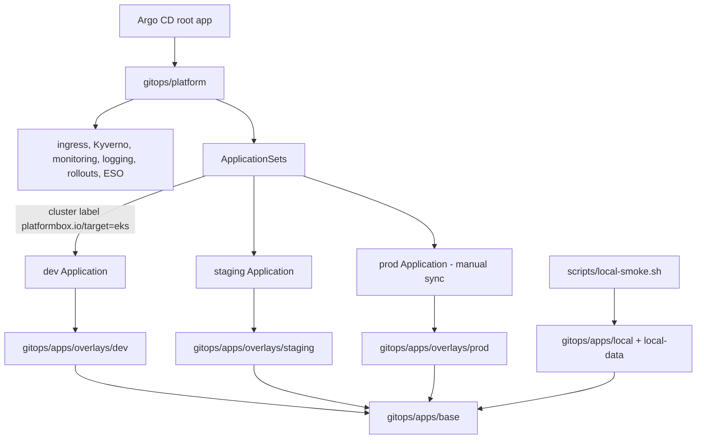

# Application delivery architecture

**Purpose.** This document explains how the Phase 4 application manifests are
organised, how an image promotion reaches each environment, and what runs in
the local `kind` demo. It describes the current repository, not a future wish
list.

**How to verify the claims.** Run `make check` for static validation and
`make local-smoke` for runtime evidence. The exact rendered resource counts are
printed by `scripts/gitops-validate.sh`. Anything that needs AWS is labelled as
design-only and has not been executed.

## Layers



The root Application follows `main` after a phase merge. While a branch is
under review, `scripts/local-up.sh` points it at that branch if it exists on
`origin` (ADR-013). The ApplicationSets themselves follow `main` in their
generated Application templates.

## Kustomize structure

| Path | Purpose |
|---|---|
| `gitops/apps/base` | Shared workloads and policies for all environments |
| `gitops/apps/overlays/dev` | Namespace `app-dev`, one replica, smaller resources, fault injection on |
| `gitops/apps/overlays/staging` | Namespace `app-staging`, base resources, fault injection on |
| `gitops/apps/overlays/prod` | Namespace `app-prod`, three replicas, larger resources, fault injection off, manual sync |
| `gitops/apps/local` | kind-only overlay: local images, nginx ingress, fake secret store |
| `gitops/apps/local-data` | kind-only in-cluster PostgreSQL and Redis |

Every application namespace enforces Pod Security Standards `restricted` and
gets a default-deny NetworkPolicy with explicit allows for DNS, frontend → API,
API/worker → data, ingress, and Prometheus scraping. `app-data` uses `baseline`
because the pinned PostgreSQL image must write its data directory as uid 999;
that exception is recorded in ADR-017.

Per service the base provides:

| Service | Workload | Port | Probes | Extras |
|---|---|---|---|---|
| api | Argo Rollout (basic rolling update) | 8000 | `/health`, `/ready` | ServiceMonitor, HPA, PDB, ExternalSecret, ALB Ingress |
| worker | Deployment | 8001 | `/health`, `/ready` | ServiceMonitor, HPA, PDB, ExternalSecret |
| frontend | Deployment | 8080 (Service 80) | `/` | HPA, PDB, ALB Ingress |

The canary strategy steps and Prometheus analysis are Phase 8. Phase 4 uses a
`canary` strategy with no steps, which Argo Rollouts treats as a basic rolling
update; the pinned v1.7.2 CRD does not support `spec.strategy.rollingUpdate`.
See ADR-018.

## Image placeholder mechanism

The base and each environment overlay contain one `images:` entry per service:

```yaml
images:
  - name: ghcr.io/akashhh15/platformbox/api
    newTag: dev
```

CI edits the overlay entry, not the workload manifest:

```bash
cd gitops/apps/overlays/dev
kustomize edit set image ghcr.io/akashhh15/platformbox/api:<immutable-tag>
kustomize edit set image ghcr.io/akashhh15/platformbox/worker:<immutable-tag>
kustomize edit set image ghcr.io/akashhh15/platformbox/frontend:<immutable-tag>
```

This was verified with the pinned Kustomize 5.8.3 and is recorded in ADR-014.
The resulting diff is the reviewable promotion commit. `latest` is never used.

## Promotion model

| Stage | Sync | Who changes the image tag |
|---|---|---|
| dev | Argo CD automated, prune + self-heal | CI after a successful build (Phase 5) |
| staging | Argo CD automated, prune + self-heal | CI in the same write-back commit as dev |
| prod | Manual Argo CD sync | Human after approval copies the verified staging tag into the prod overlay |

Dev and staging use the same generated commit, so staging receives the exact
artefact that passed dev. Prod never auto-syncs: a human must both update the
prod overlay and click **SYNC**. This is deliberate, not a missing automation
step. Phase 5 implements the write-back; Phase 4 supplies the editable files
and the ApplicationSet behaviour.

Fault injection follows the same gate. The API serves
`POST /chaos/fail` only when `FAULT_INJECTION_ENABLED=true`. The base defaults
to `false`; dev, staging and local opt in, prod never does. The namespace label
`platformbox.io/fault-injection` records the same intent for future chaos
tooling (Phase 9).

## Secrets and ingress

AWS overlays reference a `ClusterSecretStore` named `aws-secretsmanager`. Two
ExternalSecrets extract JSON from `platformbox/database` and `platformbox/redis`
and template the URLs consumed by the workloads. No secret value is in Git.

Each Ingress uses AWS Load Balancer Controller annotations: internet-facing
scheme, `target-type: ip`, and a health-check path. TLS is added only when a
domain variable is supplied by the human; Phase 4 commits no hostname and no
certificate ARN. On kind, `gitops/apps/local` patches the class to `nginx` and
uses the fake ESO store from ADR-016.

The base NetworkPolicies allow ingress from `ingress-nginx` because that is the
local load balancer substitute. The AWS path additionally needs an `ipBlock`
allow for the VPC CIDR so ALB traffic reaches the pods; that value is a human
input and is listed in `docs/SETUP.md` under human tasks. It is not applied or
guessed here.

## What is not proven locally

- ALB target groups, ACM certificates and ExternalDNS.
- AWS Secrets Manager rotation and IRSA-based ESO authentication.
- Managed RDS/ElastiCache endpoints. The base egress rules therefore target the
  `app-data` namespace, which only exists in the local smoke overlay.
- Real canary analysis (Phase 8) and SLO burn-rate alerts (Phase 7).

## References

- [ADR-004: Local substitutes](adr/ADR-004-local-substitutes.md)
- [ADR-014: Kustomize image placeholders](adr/ADR-014-kustomize-image-placeholders.md)
- [ADR-015: Cluster-gated ApplicationSets](adr/ADR-015-cluster-gated-applicationsets.md)
- [ADR-016: Local fake secret store](adr/ADR-016-local-fake-secret-store.md)
- [ADR-017: Baseline PSS for local data](adr/ADR-017-baseline-pss-for-local-data.md)
- [ADR-018: Canary strategy without steps](adr/ADR-018-canary-without-steps.md)
