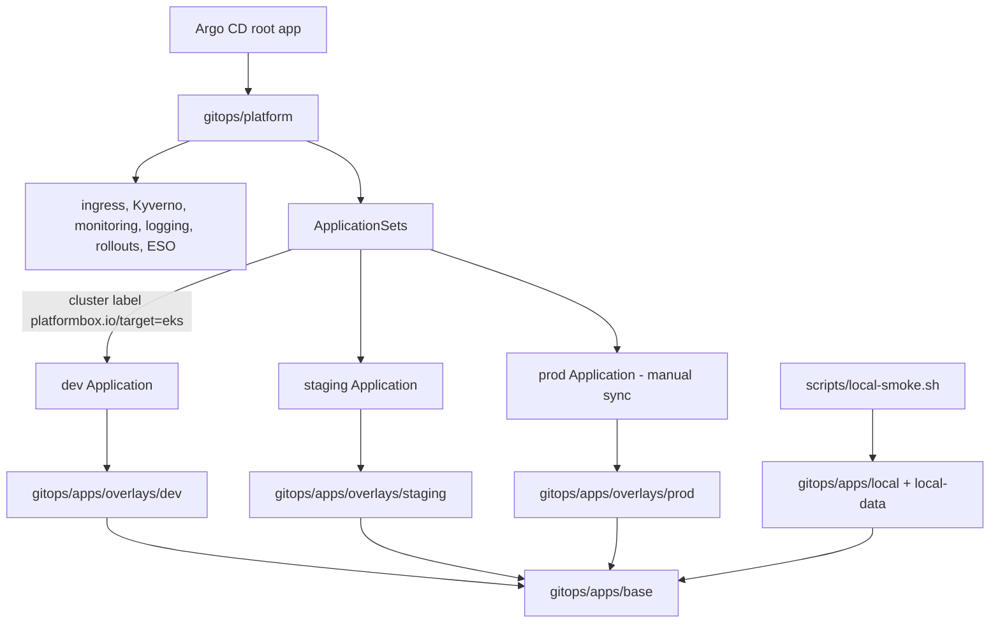

# Application delivery architecture

**Purpose.** This document explains how the application manifests are
organised, how an image promotion reaches each environment, what runs in the
local `kind` demo, and how Phase 7 metrics, logs, SLOs and alerts are wired. It
describes the current repository, not a future wish list.

**How to verify the claims.** Run `make check` for static validation and
`make local-smoke` for runtime evidence. The exact rendered resource counts are
printed by `scripts/gitops-validate.sh`. `scripts/apps-contract.sh` asserts the
shared workload contract and the documented local/AWS substitutions across all
four overlays; `terraform test` checks the ECR, budgets, IRSA and bootstrap
contracts with mock providers. ADR-020 records why the AWS path is verified this
way. Anything that needs AWS is labelled as design-only and has not been
executed.

## Layers



The root Application follows `main` after a phase merge. While a branch is
under review, `scripts/local-up.sh` points it at that branch if it exists on
`origin` (ADR-013). The ApplicationSets themselves follow `main` in their
generated Application templates.

## Kustomize structure

| Path | Purpose |
|---|---|
| `gitops/apps/base` | Shared workloads and policies for all environments |
| `gitops/apps/overlays/dev` | Namespace `app-dev`, one replica, smaller resources, fault injection on |
| `gitops/apps/overlays/staging` | Namespace `app-staging`, base resources, fault injection on |
| `gitops/apps/overlays/prod` | Namespace `app-prod`, three replicas, larger resources, fault injection off, manual sync |
| `gitops/apps/local` | kind-only overlay: local images, nginx ingress, fake secret store |
| `gitops/apps/local-data` | kind-only in-cluster PostgreSQL and Redis |

Every application namespace enforces Pod Security Standards `restricted` and
gets a default-deny NetworkPolicy with explicit allows for DNS, frontend → API,
API/worker → data, ingress, and Prometheus scraping. `app-data` uses `baseline`
because the pinned PostgreSQL image must write its data directory as uid 999;
that exception is recorded in ADR-017.

Per service the base provides:

| Service | Workload | Port | Probes | Extras |
|---|---|---|---|---|
| api | Argo Rollout (replica-weighted canary) | 8000 | `/health`, `/ready` | ServiceMonitor, HPA, PDB, ExternalSecret, ALB Ingress |
| worker | Deployment | 8001 | `/health`, `/ready` | ServiceMonitor, HPA, PDB, ExternalSecret |
| frontend | Deployment | 8080 (Service 80) | `/` | HPA, PDB, ALB Ingress |

The API Rollout declares `setWeight` steps of 10, 25, 50 and 100 with a 30-second
pause after each. There is no traffic router, so Argo Rollouts approximates each
weight with replica counts; four API replicas make one and two canary pods
correspond to 25% and 50%. Two Prometheus `AnalysisTemplate`s start with the
canary and query only pods carrying the latest `rollouts-pod-template-hash`.
Two failed measurements abort the rollout and return all traffic to the stable
ReplicaSet. See ADR-026 and [docs/demo.md](demo.md).

## Image placeholder mechanism

The base and each environment overlay contain one `images:` entry per service:

```yaml
images:
  - name: ghcr.io/akashhh15/platformbox/api
    newTag: dev
```

CI edits the overlay entry, not the workload manifest:

```bash
cd gitops/apps/overlays/dev
kustomize edit set image ghcr.io/akashhh15/platformbox/api:<immutable-tag>
kustomize edit set image ghcr.io/akashhh15/platformbox/worker:<immutable-tag>
kustomize edit set image ghcr.io/akashhh15/platformbox/frontend:<immutable-tag>
```

This was verified with the pinned Kustomize 5.8.3 and is recorded in ADR-014.
The resulting diff is the reviewable promotion commit. `latest` is never used.

## Promotion model

| Stage | Sync | Who changes the image tag |
|---|---|---|
| dev | Argo CD automated, prune + self-heal | CI after a successful build (Phase 5) |
| staging | Argo CD automated, prune + self-heal | CI in the same write-back commit as dev |
| prod | Manual Argo CD sync | Human after approval copies the verified staging tag into the prod overlay |

Dev and staging use the same generated commit, so staging receives the exact
artefact that passed dev. Prod never auto-syncs: a human must both update the
prod overlay and click **SYNC**. This is deliberate, not a missing automation
step. Phase 5 implements the write-back; Phase 4 supplies the editable files
and the ApplicationSet behaviour.

Fault injection follows the same gate. The API serves
`POST /chaos/fail` only when `FAULT_INJECTION_ENABLED=true`. The base defaults
to `false`; dev, staging and local opt in, prod never does. The namespace label
`platformbox.io/fault-injection` records the same intent for future chaos
tooling (Phase 9).

## Secrets and ingress

AWS overlays reference the `ClusterSecretStore` named `aws-secretsmanager`,
defined in `gitops/platform/aws-secrets-store/clustersecretstore.yaml`. It uses
IRSA through the ESO chart's `external-secrets` ServiceAccount. A human
annotates that ServiceAccount with the role ARN output by Terraform before the
store can read anything. An EKS-gated ApplicationSet (`ADR-019`) installs the
store only on clusters labelled `platformbox.io/target: eks`, so the local kind
cluster never receives an invalid provider configuration. Two ExternalSecrets
extract JSON from `platformbox/database` and `platformbox/redis` and template
the URLs consumed by the workloads. No secret value or role ARN is in Git.

Each Ingress uses AWS Load Balancer Controller annotations: internet-facing
scheme, `target-type: ip`, and a health-check path. TLS is added only when a
domain variable is supplied by the human; Phase 4 commits no hostname and no
certificate ARN. On kind, `gitops/apps/local` patches the class to `nginx` and
uses the fake ESO store from ADR-016.

The base NetworkPolicies allow ingress from `ingress-nginx` because that is the
local load balancer substitute. The AWS path additionally needs an `ipBlock`
allow for the VPC CIDR so ALB traffic reaches the pods; that value is a human
input and is listed in `docs/SETUP.md` under human tasks. It is not applied or
guessed here.

## Observability and SLOs

All Phase 7 resources are code under `gitops/platform/observability`. The Grafana
sidecar imports six dashboard ConfigMaps labelled `grafana_dashboard: "1"`; the
Prometheus Operator selects the `PrometheusRule` and platform `ServiceMonitor`
resources by the labels configured in `gitops/platform/monitoring.yaml`.

| Dashboard | Main signal | Local availability |
|---|---|---|
| Cluster overview | CPU, memory, node and pod health | Full |
| Nodes and Karpenter | Node count, pending pods, CloudProvider errors, NodeClaims | Node panels full; Karpenter panels AWS-only |
| Argo CD | Sync status, health status, sync operations | Full |
| API RED | Rate, 5xx ratio, p95, error budget, canary/stable ReplicaSet hash, canary replica fraction | Full after `make local-smoke` |
| Worker | Queue depth, job rate, p95 job duration, invalid JSON | Full after `make local-smoke` |
| Kyverno | ValidatingPolicy failures, result modes, execution p95 | Full |

Scrape sources are explicit. The API and worker `ServiceMonitor` resources add
`app.kubernetes.io/version` and, for the API Rollout,
`rollouts-pod-template-hash` as target labels. `scripts/local-up.sh` enables the
Argo CD application-controller metrics Service, `gitops/platform/argo-rollouts.yaml`
enables the Rollouts controller metrics Service, and an observability
`ServiceMonitor` selects each one. Kyverno's four metrics Services are selected
by one `ServiceMonitor`. The Karpenter Helm chart in
`infra/modules/karpenter/main.tf` creates its own `ServiceMonitor` with the
`release: monitoring` label; no Karpenter component runs on kind.

The worker exposes custom Prometheus metrics from `apps/worker/src/metrics.py`:
queue depth, jobs by result and job duration histogram. Both Python services
emit structured JSON with static `service`, `environment` and `version` fields,
and Promtail promotes those fields plus `level` to Loki labels. The saved
queries are in [docs/log-queries.md](log-queries.md).

### SLO math

The availability SLO is 99.5% over a rolling 30 days, so the error budget is
`1 - 0.995 = 0.005`, or 0.5%. For each window `w`, the recording rule computes:

```text
error_ratio_w = sum(rate(http_requests_total{status="5xx"}[w]))
                / sum(rate(http_requests_total[w]))
```

Probes and the opt-in chaos endpoint are excluded from both numerator and
denominator. A burn rate is `error_ratio_w / error_budget`. Following the Google
SRE Workbook, a fast-burn alert requires both the 1h and 5m ratios to exceed
`14.4 x 0.005 = 0.072`; at that rate a 30-day budget loses about 2% per hour.
A slow-burn alert requires both the 6h and 30m ratios to exceed
`6 x 0.005 = 0.03`; that consumes about 5% of the budget over six hours. Both
conditions must hold so a short spike does not page and a sustained regression
still does.

The latency SLO is provisional: at least 95% of the same requests below 500 ms,
giving a 5% error budget. Its burn thresholds are `14.4 x 0.05 = 0.72` and
`6 x 0.05 = 0.30`. The 500 ms value is a starting point for a small local demo,
not a measured production target. `TODO(measure):` run the Phase 9 k6 profile,
record p95 under normal and degraded conditions, then revise the threshold and
update ADR-024.

Recording rules also expose 30-day error-budget-remaining gauges. Prometheus
retention is therefore 30 days. Resource requests and limits for Prometheus,
Grafana, Alertmanager, the operator, node-exporter, kube-state-metrics, Loki and
Promtail are explicit starting points for a disposable dev cluster.
`TODO(measure):` capture 7 days of kind usage and resize from observed CPU,
memory and TSDB growth. Loki retention is 168 hours with the compactor enabled;
Prometheus and Loki persistence remain disabled on kind, so both stores are
ephemeral by design.

### Alert delivery

Ten alerts are defined: four API SLO burn alerts and six platform alerts. Each
carries `severity`, `summary`, `description` and a `runbook_url`; all ten runbooks
are under `docs/runbooks/`. The pinned chart's default Alertmanager config has
a `null` receiver, so kind works without any notification secret. Slack is
generated only for EKS clusters explicitly labelled
`platformbox.io/slack-alerting: "true"`; an ExternalSecret reads the webhook
from AWS Secrets Manager. See [ADR-025](adr/ADR-025-opt-in-slack-alert-routing.md).

Static verification is `bash scripts/observability-validate.sh`, called by
`make gitops-validate`: it extracts the rule spec, runs `promtool check rules`
and `promtool test rules`, validates dashboard JSON, checks alert metadata and
runbook links, and asserts that Slack stays opt-in. Runtime verification on kind
is described in `docs/SETUP.md`.

### Progressive delivery

Argo CD notifications and Argo Rollouts notifications use the same delivery
path: both post Alertmanager-format alerts to the Alertmanager Service in
`monitoring`. Argo CD emits `ArgoCDSyncFailed` and `ArgoCDHealthDegraded`;
Argo Rollouts emits `RolloutAborted` and `RolloutAnalysisFailed`. Alertmanager
keeps the chart's null receiver on kind and sends to Slack only on clusters
labelled `platformbox.io/slack-alerting: "true"`, so no webhook secret is needed
locally. ADR-027 records the shared delivery path. The Argo CD values file is
shared by `scripts/local-up.sh` and both Terraform environments; the Rollouts
values live in `gitops/platform/argo-rollouts.yaml`.

`bash scripts/progressive-validate.sh` substitutes the canary hash argument,
runs `promtool check rules` on both analysis queries, checks notification config
keys, validates the canary dashboard panels and runs `bash -n` on both demo
scripts and checks the demo patch contracts. `bash scripts/helm-lint.sh`
additionally renders the shared Argo CD values against charts 10.18.2 and 7.0.0
and the Rollouts values against chart 2.38.0.

## What is not proven locally

- ALB target groups, ACM certificates and ExternalDNS.
- AWS Secrets Manager rotation and IRSA-based ESO authentication.
- Managed RDS/ElastiCache endpoints. The base egress rules therefore target the
  `app-data` namespace, which only exists in the local smoke overlay.
- Karpenter alert data and Slack webhook delivery. Both are AWS-only by design;
  the manifest shape and gating are validated offline.
- Exact ALB traffic weights, real ALB target-group health and live Slack
  delivery. The replica-weighted canary and Alertmanager null receiver are the
  local substitutes (ADR-026, ADR-027).
- Analysis queries are syntax-checked offline and the full rollback path is
  documented in [docs/demo.md](demo.md); no sustained production traffic has
  been generated here.

## References

- [ADR-004: Local substitutes](adr/ADR-004-local-substitutes.md)
- [ADR-014: Kustomize image placeholders](adr/ADR-014-kustomize-image-placeholders.md)
- [ADR-015: Cluster-gated ApplicationSets](adr/ADR-015-cluster-gated-applicationsets.md)
- [ADR-016: Local fake secret store](adr/ADR-016-local-fake-secret-store.md)
- [ADR-017: Baseline PSS for local data](adr/ADR-017-baseline-pss-for-local-data.md)
- [ADR-018: Canary strategy without steps](adr/ADR-018-canary-without-steps.md)
- [ADR-026: Replica-weighted canary](adr/ADR-026-replica-weighted-canary.md)
- [ADR-027: Argo notifications via Alertmanager](adr/ADR-027-argo-notifications-via-alertmanager.md)
