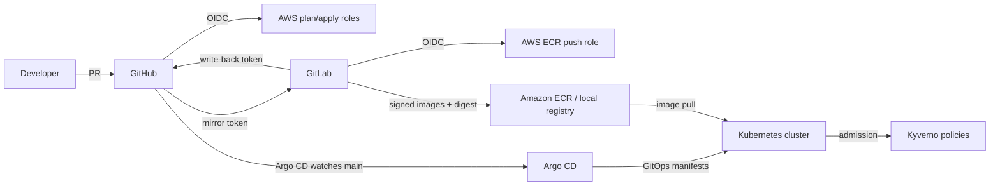

# Threat model

**Purpose.** This document records what the platform protects, where trust
changes hands, and which controls answer each threat. It describes the current
repository, including the parts that are design-only on AWS.

**How to verify the claims.** Run `make check` for static evidence:
`scripts/policy-test.sh` exercises every admission policy against compliant and
violating pods, `scripts/gitops-validate.sh` applies the policies to the rendered
dev/staging/prod/local overlays, `scripts/validate-workflows.sh` checks CI shape,
and `make scan` runs gitleaks and Checkov. Anything requiring AWS or a live
GitLab pipeline is labelled human-run and has not been executed by the agent.

## Assets

| Asset | Why it matters |
|---|---|
| Source repository | The deployment source of truth; Argo CD follows `main` |
| CI identities | GitHub OIDC roles and GitLab `id_tokens` are the only credentials allowed to touch AWS |
| Container images | The unit of code that runs in the cluster |
| GitOps image references | A promotion is a three-line edit that Argo CD deploys |
| Kubernetes secrets | Database and worker credentials delivered by External Secrets Operator |
| Cluster workloads | api, worker, frontend, PostgreSQL and Redis |
| Logs and metrics | Operational data, potentially containing request metadata |

## Trust boundaries

The important boundaries are CI → AWS (federated identity, no static keys),
CI → repository (write-back token), and Git → cluster (Argo CD is the only
deployer). Kyverno is the last gate before a workload runs.

## Threats and controls

| STRIDE | Threat | Control | Evidence |
|---|---|---|---|
| Spoofing | A fork PR assumes the apply role | Apply workflow is environment-gated; plan is fork-safe; OIDC subject is scoped to the repository and branch | `.github/workflows/terraform-apply.yml`, ADR-002 |
| Spoofing | An untrusted pipeline pushes images | GitLab OIDC role trusts only this project and `main`; no static AWS keys in CI | `.gitlab-ci.yml`, ADR-002 |
| Tampering | A mutable `:latest` image is deployed | `disallow-latest-tag` denies it; CI writes immutable tags; ADR-014 records the edit format | `make policy-test`, ADR-014 |
| Tampering | A workload gets host or root access | `disallow-host-access` and `require-container-hardening` deny host namespaces, hostPath, privileged containers, missing seccomp/readOnlyRootFilesystem/capability drop | `make policy-test` |
| Tampering | A non-compliant pod spec reaches the cluster | Five baseline policies require standard labels, resource limits, non-root, probes and no `latest`; PSS `restricted` on application namespaces | `make gitops-validate` |
| Repudiation | An image promotion has no reviewable diff | CI edits only `newTag` in one overlay per environment; the diff is the promotion record | ADR-003, ADR-014 |
| Information disclosure | Secrets are committed | gitleaks scans history; External Secrets Operator supplies values at runtime; no secrets in Git | `make scan`, ADR-016 |
| Information disclosure | Pods read each other's traffic | Default-deny NetworkPolicy plus explicit allows per namespace | `gitops/apps/base/networkpolicies.yaml` |
| Denial of service | One workload starves the node | CPU/memory requests and limits, HPA and PDB are base manifest requirements; `require-resource-limits` denies omissions | `make policy-test`, `make gitops-validate` |
| Elevation of privilege | A container escalates to root | `require-non-root` and `require-container-hardening` deny privilege escalation and missing capability drops; PSS `restricted` | `make policy-test` |
| Elevation of privilege | An unscoped CI role changes AWS | Bootstrap roles are least-privilege and scoped by OIDC subject; apply requires the protected `dev` environment | `infra/bootstrap`, ADR-002 |

## Policy scope decision

The two new hardening policies (`require-container-hardening`,
`disallow-host-access`) match only `app-dev`, `app-staging` and `app-prod`.
`app-data` stays on Pod Security Standards `baseline` because the pinned
PostgreSQL image must write its data directory as uid 999 (ADR-017), and
`app-local` is a disposable kind overlay. The baseline five policies still match
every `app-*` namespace. This keeps the demo runnable without weakening the
application namespaces. ADR-023 records the decision.

## Residual risks and human tasks

- **Image signature admission is not enforced yet.** Phase 5 signs the pushed
  digest with Cosign keyless, but no `ImageValidatingPolicy` denies unsigned
  images. A local `Deny` policy would reject the intentionally unsigned images
  built by `make local-smoke` (ADR-000, ADR-004), and the GitLab OIDC `sub` value
  cannot be scoped until the project path is confirmed. The AWS path should add
  a cluster-gated `ImageValidatingPolicy` in `Audit` first, then promote it to
  `Deny` after a real signed digest is observed. This is a human task, not a
  hidden gap.
- **AWS and GitLab live controls are design-validated only.** OIDC role trust,
  ECR push, signing and write-back are recorded in `docs/SETUP.md` §7 but have
  not been executed. No AWS resource was created by the agent.
- **Admission control is not a runtime detector.** Kyverno denies non-compliant
  manifests; it does not detect a compromised process inside a compliant pod.
  Runtime detection is outside this phase.

## References

- [ADR-002: OIDC over static credentials](adr/ADR-002-oidc-over-static-credentials.md)
- [ADR-009: CEL-based Kyverno policies](adr/ADR-009-cel-based-kyverno-policies.md)
- [ADR-017: baseline PSS for local data](adr/ADR-017-baseline-pss-for-local-data.md)
- [ADR-022: CI trust boundaries and offline validation](adr/ADR-022-ci-trust-boundaries-and-offline-validation.md)
- [ADR-023: policy scope and deferred signature admission](adr/ADR-023-policy-scope-and-deferred-signature-admission.md)
- `docs/SETUP.md` §7 for the human-run pipeline test plan
